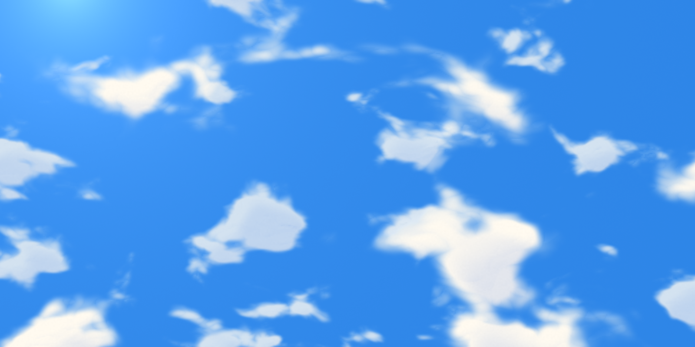

# sky-kit

Endless drifting painterly clouds on a bright blue sky — for the web (WebGL2, plain JS or React) and for Apple platforms (Metal, SwiftUI). Same look on both: the Swift port matches the web version to within 0.12/255 per pixel on average.



- Fills whatever container you put it in, at full device resolution.
- Cheap: about 2 ms per frame at 2880×1800 on an M4 (clouds are painted into snapshots that slide, see [docs/ARCHITECTURE.md](docs/ARCHITECTURE.md)).
- Pauses when off-screen or when the tab is hidden; holds still for reduced-motion users.
- Extras (web and Swift): planes with contrails; text, emoji or SVG/PNG shapes: the clouds around drift in and gather into the shape, which later spreads back out and dissolves into the sky.

## Web

No build step and no dependencies: `web/src/sky.js` is a plain ES module.

```js
import { createSky } from './web/src/sky.js';   // or 'sky-kit' once installed

const sky = createSky(document.querySelector('#hero'), { coverage: 0.6 });
sky.set({ palette: 'pastel', speed: 2 });   // change anything live
sky.showShape({ text: 'hello' });           // nearby clouds gather into "hello", hold, then melt back
sky.flyPlane();
sky.destroy();
```

The container needs a size (any CSS size). Overlay content can go inside it: the sky canvas sits underneath (the container becomes `isolation: isolate`) and ignores pointer events. Options set to `undefined` mean "use the default".

### React

```jsx
import { Sky } from 'sky-kit/react';

function Hero() {
  const sky = useRef(null);
  return (
    <Sky ref={sky} coverage={0.6} style={{ height: 480 }}>
      <h1>Overlay content</h1>
      <button onClick={() => sky.current.showShape({ text: 'hi' })}>Say hi</button>
    </Sky>
  );
}
```

Props are the options below; changing a prop updates the sky live, and removing one returns it to its default. The ref exposes `flyPlane`, `showShape`, `clearShape`, `pause`, `play`, `snapshot`, `canvas` and `options`. The wrapper is plain JS (`createElement`, no JSX), works with React 17+, StrictMode and SSR (the sky is created in an effect). TypeScript types are included (`sky.d.ts`, `react.d.ts`).

### Options

| Option | Default | |
|---|---|---|
| `speed` | `1` | 0 = still, 1 = gentle drift, 4 = brisk |
| `coverage` | `0.6` | 0 = almost clear … 1 = lots of cloud |
| `shadow` | `0.3` | shading inside clouds |
| `cloudScale` | `1` | cloud size multiplier |
| `direction` | `'left'` | `'left'` or `'right'` |
| `seed` | `0` | any number gives a different sky |
| `palette` | `'summer'` | `'summer'`, `'day'`, `'pastel'` |
| `skyTop`, `skyMid`, `skyLow` | `null` | custom hex colours, override the palette |
| `gradient` | `0` | 0 = even blue sky, 1 = deep blue fading to a pale horizon |
| `quality` | `'high'` | `'high'`, `'balanced'`, `'low'` (snapshot resolution) |
| `fps` | `60` | frame cap |
| `planes` | `false` | occasional planes with contrails |
| `trailLife` | `40` | seconds a contrail lingers |
| `respectReducedMotion` | `true` | hold still when the user prefers reduced motion |

Methods: `set(options)`, `pause()`, `play()`, `flyPlane({ from, to }?)`, `showShape({ text | image, x, y, size, form, hold, fade })`, `clearShape()`, `snapshot()` (PNG data URL), `destroy()`.

`showShape` accepts text/emoji or an image (URL, ``, canvas): transparent images use their alpha, opaque ones use dark = shape. The clouds from a wide area around drift in and gather into it over `form` seconds (default 5), it holds (5), then it spreads back out and dissolves into the surrounding sky (7). It drifts with the clouds and is placed so it sits at `x, y` in the middle of its hold; it shrinks to fit 70% of the view width on narrow screens. Shapes form as the sky moves, so they need `speed > 0`.

### Examples

Serve the repo root with any static server, e.g. `python3 -m http.server 5173`, then open:

- `web/examples/index.html` — one component in a hero, cards, a phone-shaped box and a banner
- `web/examples/playground.html` — every option and extra, with controls
- `web/examples/react.html` — React (loaded from esm.sh, no build)
- `web/examples/parity.html` — pixel comparison against the Swift render (see below)

## Swift (iOS 16+, macOS 13+)

Swift Package in `swift/`. Add it as a local package (or by URL once hosted), then:

```swift
import SkyKit

struct ContentView: View {
    @State private var options = SkyOptions(coverage: 0.6)
    @StateObject private var sky = SkyController()

    var body: some View {
        SkyView(options, controller: sky)
            .ignoresSafeArea()
            .overlay(alignment: .bottom) {
                Button("Say hi") { sky.showShape(.text("hi")) }
            }
    }
}
```

`SkyOptions` has the same names and defaults as the web options (`speed`, `coverage`, `shadow`, `cloudScale`, `direction`, `seed`, `palette`, `colors`, `gradient`, `quality`, `fps`, `planes`, `trailLife`, `respectReducedMotion`). Changing the value updates the sky live. `SkyController` sends planes (`flyPlane()`), forms shapes (`showShape(.text("hi"))` or `.image(cgImage)`) and renders stills (`snapshot(width:height:)`). The view stops drawing when nothing moves (speed 0 or Reduce Motion) and wakes up when something changes.

Also included:

- `SkyRenderer` — the Metal renderer on its own, for custom views or offscreen use. `renderImage(width:height:seconds:)` returns a `CGImage` (wallpapers, thumbnails, tests).
- `swift run SkyDemo` — a macOS window with the sky, controls, planes and text shapes.
- `swift run sky-render --width 1600 --height 1000 --seconds 30 --out sky.png` — render a still from the command line (`--text hello`, `--plane`, `--seed`, `--palette`, …).

## Keeping web and Swift identical

The shaders exist twice: GLSL in `web/src/sky.js`, Metal in `swift/Sources/SkyKit/Shaders.swift`, written line for line the same. After changing either:

```bash
cd swift && swift run sky-render --width 1600 --height 1000 --seconds 30 --out out/swift-30s.png
```

then open `web/examples/parity.html` in a browser at device pixel ratio 2. It renders the same frame in WebGL and compares every pixel. Current result: mean difference 0.131/255, max 9/255, no pixels more than 8 apart.

Shapes: `sky-render --seconds 4.5 --heart --out out/swift-heart-4.5.png` and `parity.html?heart=1&seconds=4.5&png=../../swift/out/swift-heart-4.5.png` match too (mean 0.139/255, max 14/255). With extras: `sky-render --seconds 10 --text hello --plane --out out/swift-extras.png` and `parity.html?text=hello&plane=1&seconds=10&png=../../swift/out/swift-extras.png`. Sky, plane and contrail match; the only differences are in and around the letters, because the browser and CoreText draw the rounded font slightly differently.

## Known limits

- WebGL2 is required on the web (all current browsers have it).
- Shapes form as the sky moves; with `speed: 0` they don't appear.
- One shape at a time; a new one replaces the previous.
- Noise coordinates keep growing with sky time. After several days of continuous running at speed 1 the cloud shading could start to get grainy (float precision). Not a concern for normal sessions.

## Layout

```
web/src/sky.js        component (WebGL2)          web/src/react.js   React wrapper
web/src/*.d.ts        TypeScript types            web/examples/      demos and the parity check
swift/Sources/SkyKit  SkyView, SkyRenderer, SkyOptions, Metal shaders
swift/Sources/sky-render, SkyDemo                 command-line renderer, macOS demo
docs/ARCHITECTURE.md  how it works
```

No licence has been chosen yet.
