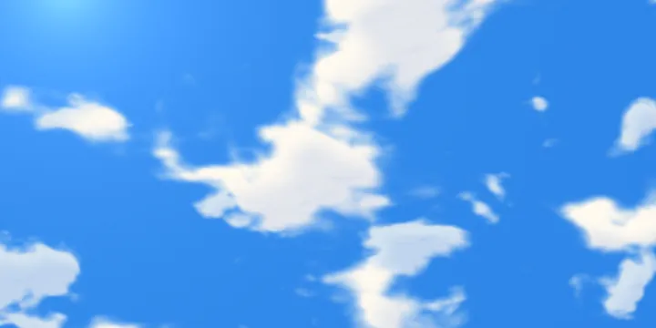
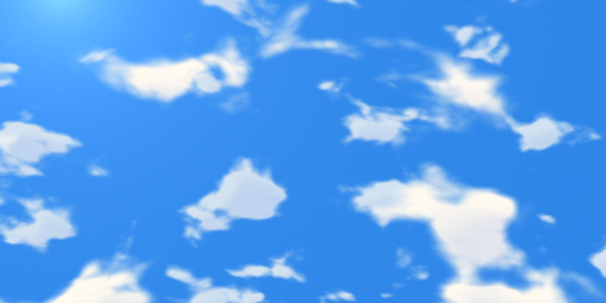

# sky-kit

Endless drifting painterly clouds on a bright blue sky — for the web (WebGL2, plain JS or React) and for Apple platforms (Metal, SwiftUI). Same look on both: the Swift port matches the web version to within about 0.13/255 per pixel on average.





- Fills whatever container you put it in, at full device resolution.
- Cheap: about 2 ms per frame at 2880×1800 on an M4 (clouds are painted into snapshots that slide, see [docs/ARCHITECTURE.md](docs/ARCHITECTURE.md)).
- Pauses when off-screen or when the tab is hidden; holds still for reduced-motion users.
- Extras (web and Swift): planes with contrails; text, emoji, built-in symbols (heart, star, sun, moon, smile, music, bolt, infinity) or SVG/PNG shapes: a real cloud near the spot reshapes into the shape, then back into itself; words can chain or morph straight into each other.

## Web

No build step and no dependencies: `web/src/sky.js` is a plain ES module.

```js
import { createSky } from './web/src/sky.js';   // or 'sky-kit' once installed

const sky = createSky(document.querySelector('#hero'), { coverage: 0.6 });
sky.set({ palette: 'pastel', speed: 2 });   // change anything live
sky.showShape({ text: 'hello' });           // a nearby cloud turns into "hello", holds it, then turns back
sky.showShape({ symbol: 'star' });          // takes over: "hello" turns into a star
sky.releaseShape();                         // melt back now
sky.flyPlane();
sky.destroy();
```

The container needs a size (any CSS size). Overlay content can go inside it: the sky canvas sits underneath (the container becomes `isolation: isolate`) and ignores pointer events. In `createSky` and the React props, options set to `undefined` mean "use the default"; `set()` leaves those unchanged.

### React

```jsx
import { Sky } from 'sky-kit/react';

function Hero() {
  const sky = useRef(null);
  return (
    <Sky ref={sky} coverage={0.6} style={{ height: 480 }}>
      <h1>Overlay content</h1>
      <button onClick={() => sky.current.showShape({ text: 'hi' })}>Say hi</button>
    </Sky>
  );
}
```

Props are the options below; changing a prop updates the sky live, and removing one returns it to its default. The ref exposes `flyPlane`, `showShape`, `releaseShape`, `clearShape`, `shapeState`, `pause`, `play`, `snapshot`, `canvas` and `options`. The wrapper is plain JS (`createElement`, no JSX), works with React 17+, StrictMode and SSR (the sky is created in an effect). TypeScript types are included (`sky.d.ts`, `react.d.ts`).

### Options

| Option | Default | |
|---|---|---|
| `speed` | `1` | 0 = still, 1 = gentle drift, 4 = brisk |
| `coverage` | `0.6` | 0 = almost clear … 1 = lots of cloud |
| `shadow` | `0.3` | shading inside clouds |
| `cloudScale` | `1` | cloud size multiplier |
| `direction` | `'left'` | `'left'` or `'right'` |
| `seed` | `0` | any number gives a different sky |
| `palette` | `'summer'` | `'summer'`, `'day'`, `'pastel'` |
| `skyTop`, `skyMid`, `skyLow` | `null` | custom hex colours, override the palette |
| `gradient` | `0` | 0 = even blue sky, 1 = deep blue fading to a pale horizon |
| `quality` | `'high'` | `'high'`, `'balanced'`, `'low'` (snapshot resolution) |
| `fps` | `60` | most frames per second; the sky draws 30 while nothing moves more than about a point a frame (a gentle drift with no plane crossing) |
| `planes` | `false` | occasional planes with contrails |
| `trailLife` | `40` | seconds a contrail lingers |
| `respectReducedMotion` | `true` | hold still when the user prefers reduced motion |

Methods: `set(options)`, `pause()`, `play()`, `flyPlane({ from, to }?)`, `showShape({ text | image | symbol, x, y, size, form, hold, fade, density, queue, pause })`, `releaseShape()`, `clearShape()`, `shapeState`, `snapshot()` (PNG data URL), `destroy()`.

`showShape` accepts text/emoji, a built-in `symbol` (`SKY_SYMBOLS`; `skySymbolSvg(name)` gives matching button icons) or an image (URL, ``, canvas): transparent images use their alpha, opaque ones use dark = shape. Every part of a shape, down to a small dot, forms (its edge comes from the distance to the outline, not from a blur). It is put on a real cloud near `x, y`, which reshapes into it over `form` seconds (default 5); it holds (5; `Infinity` = until released); then it reshapes back into that cloud (7), which stays. `releaseShape()` melts it back from wherever it is (forming, holding or morphing) and drops the queue; `clearShape()` removes it at once. `shapeState` says what is happening (`phase`: none, waiting, forming, holding or melting; `label`; `next`). `density` (0–1, default 0.5 = like the clouds around): low makes the finished shape wispy and see-through, high makes it solid. Calling `showShape` while a shape is showing takes over without a jump: if that shape is holding, it turns straight into the new one; while it is still forming, as soon as it has formed; while it is melting, the new one forms right after it. A blank text or image is ignored. Bold line icons form like letters and read best; filled images become solid clouds, so keep their features chunky (fine details blur away, as in real clouds). `queue: true` waits for the current shape to melt and then forms on the same cloud (when it is still there), so `showShape({ text: 'one' })` followed by `showShape({ text: 'two', queue: true })` gives word, cloud, next word, cloud. `pause` (seconds, default 1) is how long the cloud shows in between; with `pause: 0` the first word turns straight into the next once it has held, letter shapes blending puff by puff (over the next word's `form` seconds), first where the old word is and then outward, so a longer word grows out of a shorter one.

### Examples

Serve the repo root with any static server (`bun run serve` does), then open:

- `web/examples/index.html` — one component in a hero, cards, a phone-shaped box and a banner
- `web/examples/playground.html` — every option and extra, with controls: words (chained with commas, looped), symbols, images, Stop, and the shape timing, pause, density and size
- `web/examples/react.html` — React (loaded from esm.sh, no build)
- `web/examples/parity.html` — pixel comparison against the Swift render (see below)

## Swift (iOS 16+, macOS 13+)

A Swift package (the manifest is at the repo root, the sources in `swift/`). Add it in Xcode with File › Add Package Dependencies, or in `Package.swift`:

```swift
.package(url: "https://github.com/filip-pilar/sky-kit", from: "0.1.0")
```

then:

```swift
import SkyKit

struct ContentView: View {
    @State private var options = SkyOptions(coverage: 0.6)
    @StateObject private var sky = SkyController()

    var body: some View {
        SkyView(options, controller: sky)
            .ignoresSafeArea()
            .overlay(alignment: .bottom) {
                Button("Say hi") { sky.showShape(.text("hi")) }
            }
    }
}
```

`SkyOptions` has the same names and defaults as the web options (`speed`, `coverage`, `shadow`, `cloudScale`, `direction`, `seed`, `palette`, `colors`, `gradient`, `quality`, `fps`, `planes`, `trailLife`, `respectReducedMotion`). Changing the value updates the sky live. `SkyController` sends planes (`flyPlane()`), forms shapes (`showShape(.text("hi"))`, `.symbol(.star)` or `.image(cgImage)`, with the same `form`, `hold` (`.infinity` = until released), `fade`, `density`, `queue` and `pause` settings), melts them back (`releaseShape()`), reports `shapeState` and renders stills (`snapshot(width:height:)`). The view stops drawing when nothing moves (speed 0 or Reduce Motion) and wakes up when something changes.

Also included:

- `SkyRenderer` — the Metal renderer on its own, for custom views or offscreen use. `renderImage(width:height:seconds:)` returns a `CGImage` (wallpapers, thumbnails, tests).
- `swift run -c release SkyDemo` — a macOS window with the sky and its controls: words (chained with commas, Loop), the symbols, Stop, the forming, hold, melt, pause, density and size settings, planes.
- `swift run -c release sky-render --width 1600 --height 1000 --seconds 30 --out sky.png` — render a still from the command line (`--text hello`, `--plane`, `--seed`, `--palette`, …).

## Developing

`bun install` once, then `bun run check` (JS syntax and lint, Swift build and tests). For changes to the rendering, `bun run regress:baseline` before and `bun run regress` after: both ports render 21 scenes and compare them pixel by pixel. [AGENTS.md](AGENTS.md) has the rest.

## Keeping web and Swift identical

The shaders exist twice: GLSL in `web/src/sky.js`, Metal in `swift/Sources/SkyKit/Shaders.swift`, written line for line the same. After changing either:

```bash
swift run -c release sky-render --width 1600 --height 1000 --seconds 30 --out swift/out/swift-30s.png
```

then open `web/examples/parity.html` in a browser at device pixel ratio 2. It renders the same frame in WebGL and compares every pixel. Current result: mean difference about 0.13/255, max 9/255, almost no pixels more than 8 apart.

Shapes: `sky-render --seconds 9 --symbol smile --out swift/out/swift-smile.png` and `parity.html?symbol=smile&seconds=9&png=../../swift/out/swift-smile.png` compare a symbol (add `--release-at 3` / `release=3` for releasing). `sky-render --seconds 4.5 --heart --out swift/out/swift-heart-4.5.png` and `parity.html?heart=1&seconds=4.5&png=../../swift/out/swift-heart-4.5.png` match too (mean about 0.15/255 while forming and melting). With extras: `sky-render --seconds 10 --text hello --plane --out swift/out/swift-extras.png` and `parity.html?text=hello&plane=1&seconds=10&png=../../swift/out/swift-extras.png`. Sky, plane and contrail match; the letters differ, because the browser and CoreText draw the rounded font slightly differently, and since a word is placed by its width the two ports can put the same word a little apart (or, now and then, on a different cloud).

## Known limits

- WebGL2 is required on the web (all current browsers have it).
- Shapes form as the sky moves; with `speed: 0` they don't appear.
- One shape at a time; a new one takes over from the previous (see above), or waits for it with `queue: true`.
- In Swift, `SkyRenderer.showShape` builds the shape on the calling thread (tens of milliseconds; `SkyController` builds it in the background). The web version builds it in a Web Worker; where a Content-Security-Policy blocks `blob:` workers (`worker-src`), it builds on the main thread in steps between frames, and the sky can stutter for a moment when a shape starts.
- Noise coordinates keep growing with sky time. After several days of continuous running at speed 1 the cloud shading could start to get grainy (float precision). Not a concern for normal sessions.

## Layout

```
web/src/sky.js        component (WebGL2)          web/src/react.js   React wrapper
web/src/*.d.ts        TypeScript types            web/examples/      demos and the parity check
web/test/             regression scenes (web)     scripts/           regress.ts, serve.ts
Package.swift         the Swift package           swift/Tests/       Swift tests
swift/Sources/SkyKit  SkyView, SkyRenderer, SkyOptions, Metal shaders, shape masks and symbols
swift/Sources/sky-render, SkyDemo                 command-line renderer, macOS demo
docs/ARCHITECTURE.md  how it works
```

## Licence

MIT, see [LICENSE](LICENSE).
